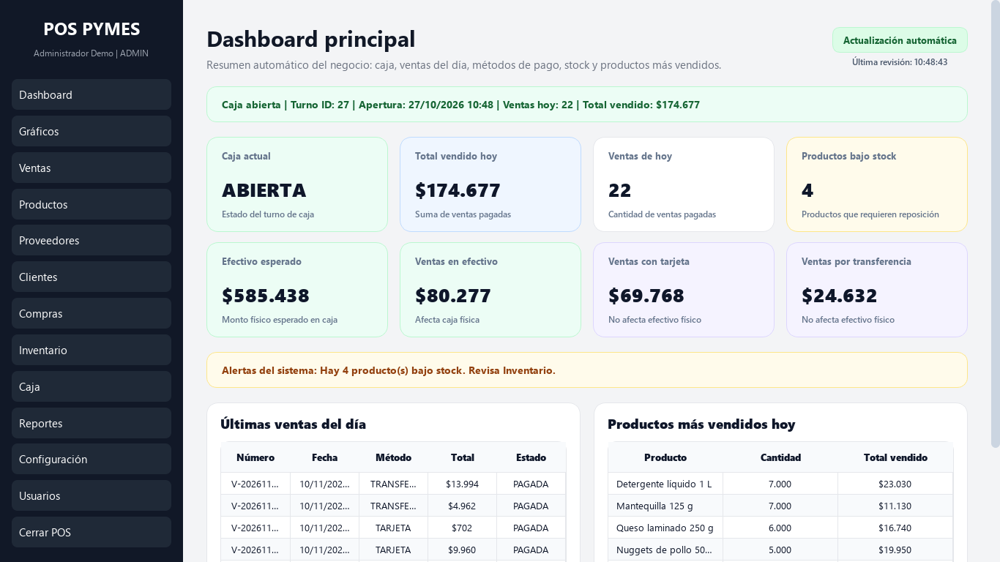
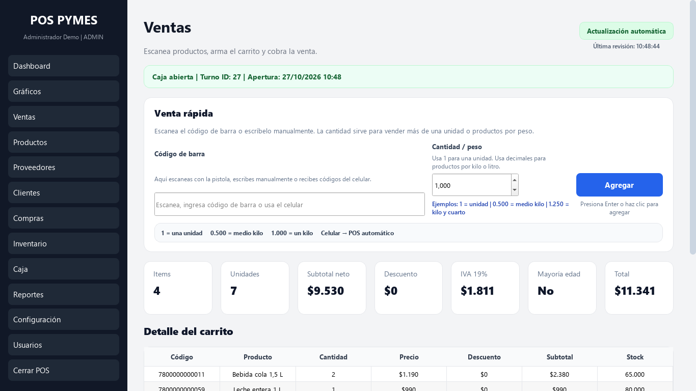
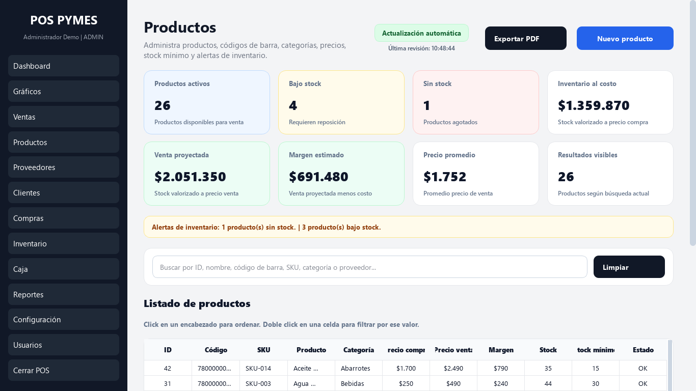
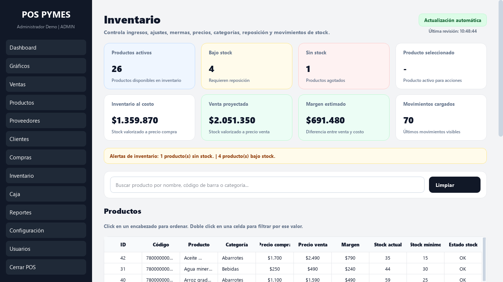
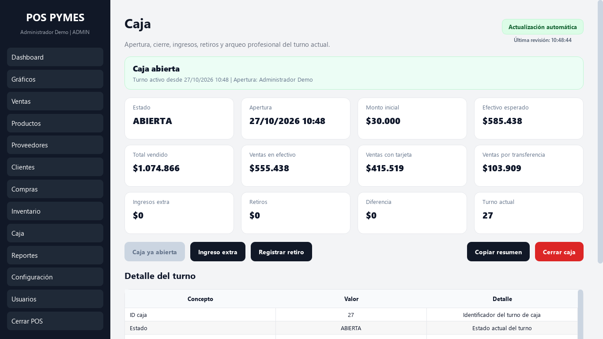
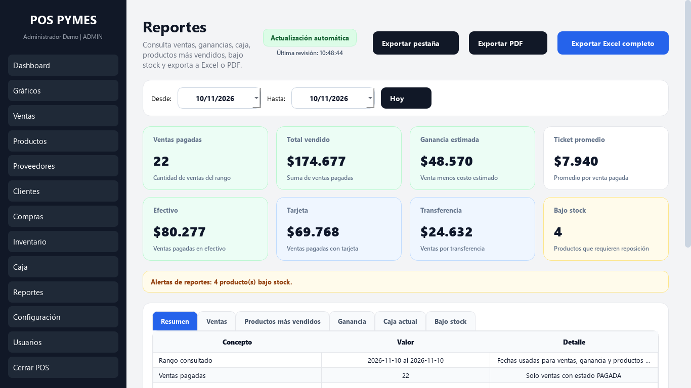
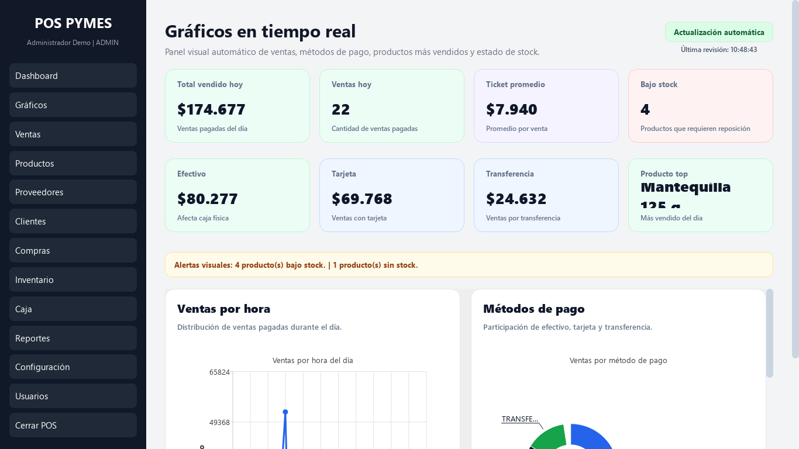
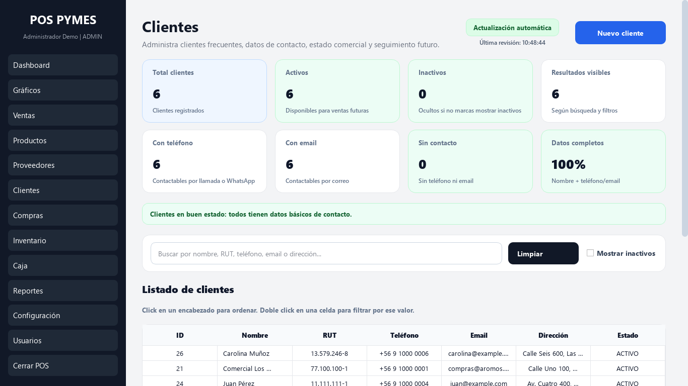
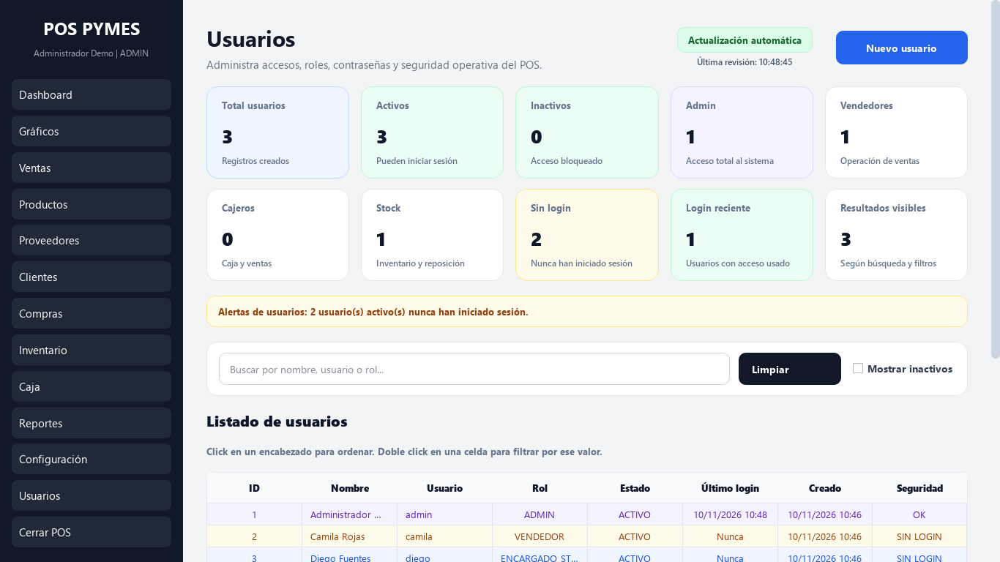
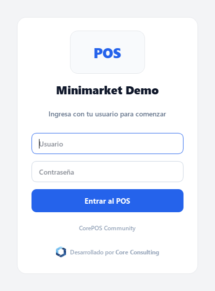

<p align="center">
  <a href="https://coreconsulting.cl">
    <picture>
      <source media="(prefers-color-scheme: dark)" srcset="docs/img/logo-core-consulting-oscuro.png">
      
    </picture>
  </a>
</p>

# Sistema Punto de Venta Open Source Code


Punto de venta de escritorio para pymes (Windows), hecho en **Python + PySide6 + MySQL**.
Edición comunitaria y gratuita, con IVA 19 % (Chile).

**Aplicación desarrollada por [Core Consulting](https://coreconsulting.cl).**

## Vista previa

> Capturas con datos de demostración **ficticios** (negocio "Minimarket Demo", productos, clientes y ventas inventados).

<p align="center">
  
</p>

| | |
|---|---|
| <br>**Ventas**: lector de código de barras, carrito, IVA y cobro | <br>**Productos**: catálogo, márgenes, stock y alertas |
| <br>**Inventario**: ingresos, ajustes, mermas y reposición | <br>**Caja**: apertura, arqueo, ingresos y retiros |
| <br>**Reportes**: ventas, ganancia y exportación a Excel/PDF | <br>**Gráficos**: ventas por hora y por método de pago |
| <br>**Clientes**: fichas y datos de contacto | <br>**Usuarios**: roles `ADMIN`, `VENDEDOR` y `ENCARGADO_STOCK` |

<details>
<summary>Pantalla de ingreso</summary>



</details>

## Funcionalidades
| Área | Detalle |
|---|---|
| Ventas | Carrito, pago en efectivo / tarjeta / transferencia / mixto, anulación con devolución de stock |
| Caja | Apertura y cierre de turnos, control de movimientos |
| Productos e inventario | Catálogo, categorías, código de barras, movimientos de stock |
| Compras y proveedores | Registro de compras con detalle y actualización de stock |
| Clientes | Ficha y historial |
| Reportes | Dashboard, gráficos (matplotlib) y exportación a Excel |
| Usuarios y roles | `ADMIN`, `VENDEDOR`, `ENCARGADO_STOCK` con permisos por módulo |
| Escáner móvil | API local (FastAPI) para usar el celular como lector de códigos |
| Respaldo | Utilidad de backup de la base de datos |

## Arquitectura
```
app/
├── ui/            Interfaz PySide6 (ventana principal, páginas por módulo, estilos)
├── api/           API local FastAPI para el escáner móvil
├── ventas.py …    Lógica de negocio por módulo (ventas, caja, inventario, compras…)
├── database.py    Acceso a MySQL
├── security.py    Hash de contraseñas y permisos por rol
sql/               Esquema (una tabla por archivo) y datos iniciales
scripts/           Utilidades (generar hash del admin)
```
La lógica de negocio está separada de la interfaz: cada módulo de `app/` expone funciones
que las páginas de `app/ui/pages/` consumen.

## Instalación (desarrollo)
1. Python 3.12+ y MySQL 8.
2. `pip install -r requirements.txt`
3. Cree la base de datos: edite `sql/00_crear_base_usuario.sql` (reemplace `@@DB_PASSWORD@@`),
   genere el hash del admin con `python scripts/generar_hash.py` y péguelo en
   `sql/99_datos_iniciales.sql` (`@@ADMIN_HASH@@`). Luego ejecute en orden:
   `00_crear_base_usuario.sql`, todos los de `sql/tables/` y `99_datos_iniciales.sql`.
4. Copie `.env.example` a `.env` y complete las credenciales.
5. `python run_ui.py`

## Seguridad
- Nunca suba su `.env`.
- La API local solo acepta conexiones desde el mismo equipo; para usar el celular defina
  `POS_API_TOKEN` y envíelo en el encabezado `X-POS-Token`.
- CORS cerrado por defecto; orígenes permitidos vía `POS_API_ALLOWED_ORIGINS`.

## Edición comunitaria vs. comercial
La edición comunitaria **no incluye** boleta/factura electrónica SII, licenciamiento,
instalador ni soporte. Esas funciones pertenecen a la edición comercial.

## Roadmap
- [ ] Tests automatizados de la capa de negocio con base de datos de prueba
- [x] Capturas de pantalla
- [ ] Demo en video
- [ ] Release con ejecutable para Windows
- [ ] Internacionalización (otros países / impuestos)

## Acerca de Core Consulting
El **Sistema Punto de Venta Open Source Code** es una aplicación desarrollada por
**[Core Consulting](https://coreconsulting.cl)**. Esta versión es gratuita y de código abierto (MIT).
Su edición comercial, **CorePOS**, agrega facturación electrónica
SII (boleta, factura, guía de despacho y notas de crédito), licenciamiento por equipo, instalador para
Windows, historial de ventas con anulación y reimpresión, registro de auditoría, conciliación de tarjetas
y soporte. Más información en [coreconsulting.cl](https://coreconsulting.cl).

## Contribuir
Lea [CONTRIBUTING.md](CONTRIBUTING.md). Los issues con la etiqueta `good first issue` son un buen punto de partida.

## Licencia
MIT. Ver [LICENSE](LICENSE).

> El nombre y el logo de **Core Consulting** (archivos `docs/img/logo-core-consulting*.png`,
> `docs/img/social-preview.png` y `app/ui/assets/core-consulting-mark.png`) son marca de Core Consulting
> y **no** están cubiertos por la licencia MIT: no pueden reutilizarse para identificar productos derivados.
> Si redistribuye una versión modificada, reemplácelos por su propia marca.
